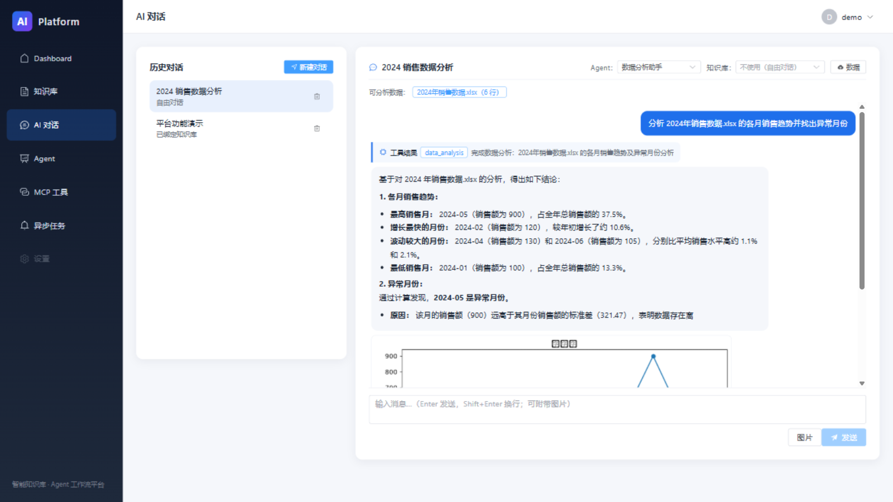
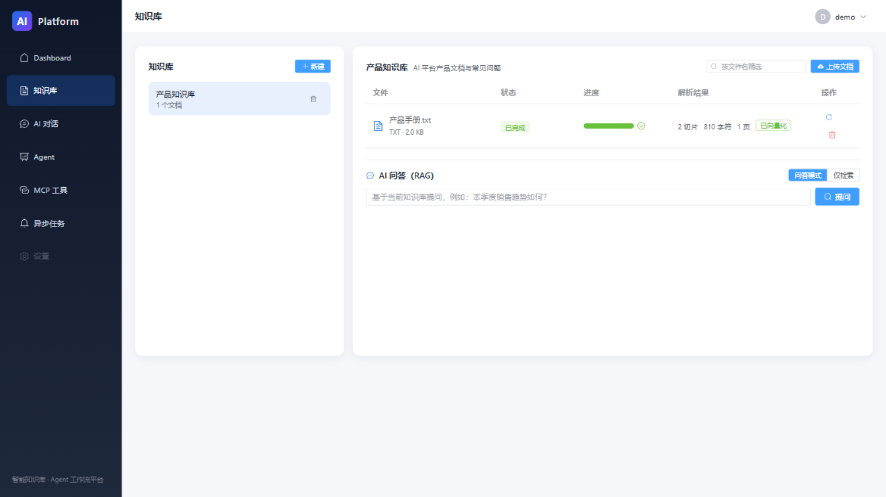
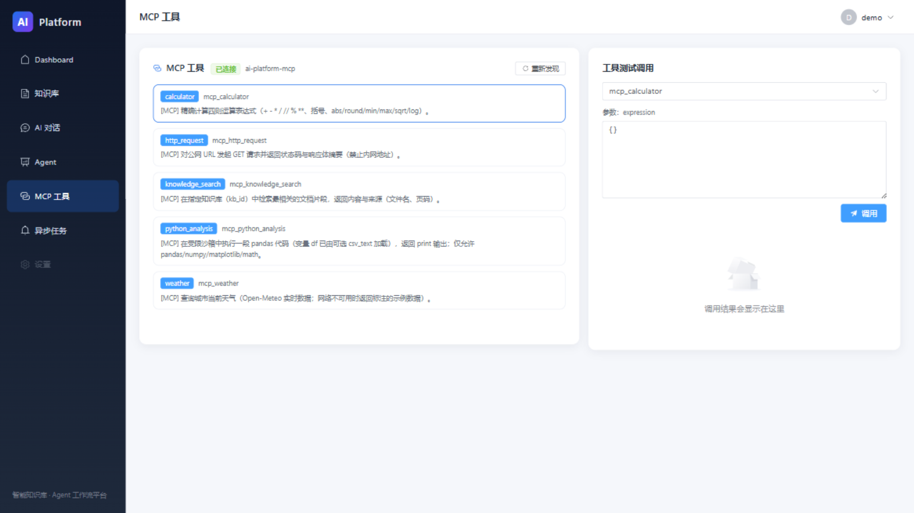
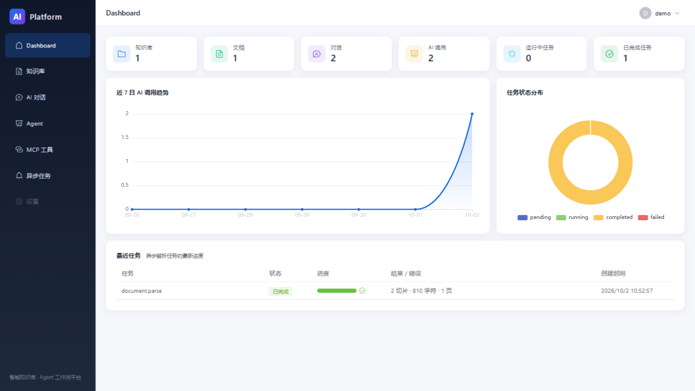
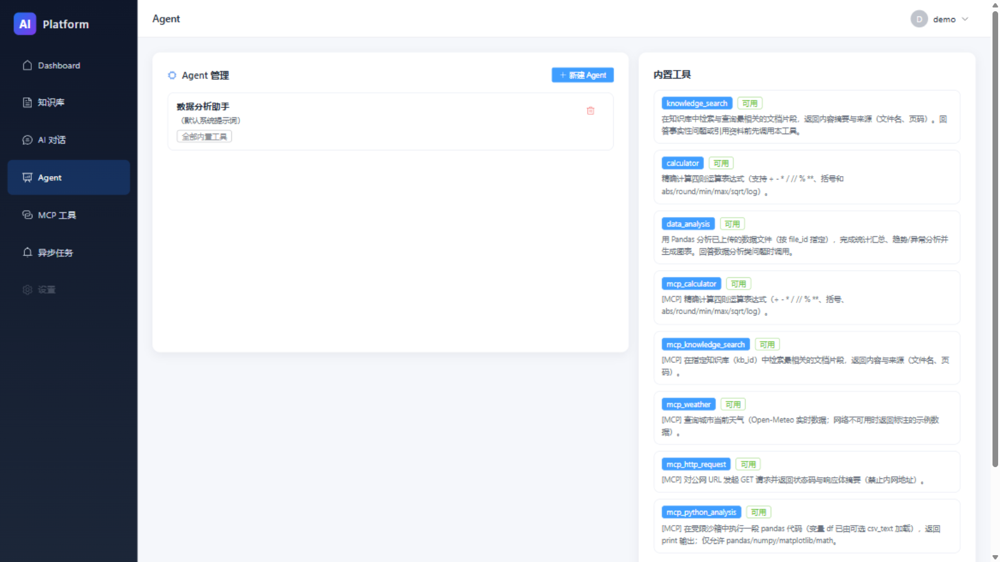

# AI 智能知识库与 Agent 工作流平台


一个生产级风格的前后端分离 AI 平台：**RAG 知识库问答**（pgvector 向量检索 + 重排 + 来源引用）、
**SSE 流式多模态对话**、**Agent 工具调用工作流**（知识检索 / 计算器 / Pandas 数据分析）、
以及一套**手写实现的 MCP Server / Client**（JSON-RPC 2.0，零 SDK 依赖）。

三层 AI Provider（Embedding / Reranker / LLM）全部抽象化——默认**零 API Key、离线可跑**，
改一行 `.env` 即可切换到任意 OpenAI 兼容厂商，或驱动容器内的**本地 Qwen3.5-0.8B 多模态模型**（含视觉理解）。

## 界面预览

**AI 对话**：Agent 工具调用时间线 · Pandas 分析结论 · 内嵌图表



**知识库**：文档上传解析 → 向量化 → RAG 问答带来源引用



**MCP 工具**：连接状态 · 工具发现 · 在线测试调用



<details>
<summary><b>更多界面</b></summary>

**Dashboard**：统计卡片 · 7 日 AI 调用趋势 · 任务分布



**Agent 管理**：提示词配置 · 工具白名单 · 数据文件管理



</details>

## 功能一览

| 模块 | 能力 |
| --- | --- |
| 📚 知识库 RAG | PDF/Word/TXT 上传 → 解析清洗切片 → Embedding 入库（pgvector HNSW）→ 向量检索 + Reranker 重排 → 回答附**文件名/页码级来源引用** |
| 💬 流式对话 | SSE 逐字输出、多轮会话历史、Markdown + 代码高亮、**图片输入**（本地视觉模型识图）、引用来源卡片 |
| 🤖 Agent 工作流 | 思考 → 工具调用 → 结果观察 → 再决策的状态机循环，前端实时步骤时间线；上传 Excel/CSV 后自动完成 Pandas 统计分析并生成 Matplotlib 图表 |
| 🔌 MCP 协议 | 按协议手写 JSON-RPC 2.0 Server（会话握手 / tools/list / tools/call）+ Client + 动态工具发现；内置 calculator、knowledge_search、weather（真实数据）、http_request（SSRF 防护）、python_analysis |
| 📊 Dashboard | 知识库/文档/会话统计、近 7 日 AI 调用趋势、任务状态分布 |
| 🔐 工程化 | JWT 认证与数据隔离（越权一律 404）、Celery 异步管线、全局异常兜底、请求日志、Alembic 迁移、Swagger 文档 |

## 架构

```
Vue 3 + TypeScript + Element Plus
│  HTTP / SSE（流式对话与步骤事件）
▼
FastAPI ──── MCP Client ────► MCP Server（JSON-RPC 2.0 · /api/mcp）
│                              ├ calculator · weather（真实数据）
│  ├ 知识库 / RAG              ├ http_request（SSRF 防护）
│  ├ Agent 工具循环            ├ knowledge_search（复用检索管线）
│  ├ 用户认证 / Dashboard      └ python_analysis（复用分析沙箱）
│
├───────────────┬────────────────────┬─────────────────┐
▼               ▼                    ▼                 ▼
PostgreSQL      Redis                Celery Worker     model-service
+ pgvector      缓存 / 任务队列       解析 → 清洗 →     OpenAI 兼容
HNSW 向量索引   （broker db1/2）      切片 → 向量化     本地 Qwen3.5-0.8B / 桩实现
```

## 技术栈

| 层 | 技术 |
| --- | --- |
| 前端 | Vue 3 · TypeScript · Vite · Element Plus · Pinia · ECharts · marked + highlight.js |
| 后端 | Python 3.14 · FastAPI · SQLAlchemy 2 · Pydantic v2 · Alembic · JWT |
| 数据 | PostgreSQL 16 + pgvector（HNSW 余弦索引） · Redis 7 |
| 异步 | Celery + Redis（文档解析与向量化管线，双降级策略） |
| AI | Provider 抽象层 · 本地 Qwen3.5（transformers, CPU/GPU 自适应） · Jina/Cohere 风格 Reranker |
| 部署 | Docker Compose 六容器编排，全部带健康检查 |

## 快速开始

```bash
cp .env.example .env            # 默认离线配置，无需任何 API Key
docker compose up -d --build    # 六容器一键启动
```

| 入口 | 地址 |
| --- | --- |
| 前端 | http://localhost:5173 |
| Swagger UI | http://localhost:8000/api/docs |
| 健康检查 | http://localhost:8000/api/v1/health |

启动后注册账号即可体验完整流程：**建知识库 → 传 PDF → 提问看引用 → 绑定 Agent 传 Excel → 自动分析出图**。

<details>
<summary><b>接入真实模型（三种方式，均为纯配置）</b></summary>

```bash
# 方式一：任意 OpenAI 兼容厂商（OpenAI / DeepSeek / SiliconFlow / 智谱 ...）
LLM_PROVIDER=openai
LLM_API_BASE=https://api.deepseek.com/v1
LLM_API_KEY=sk-xxx
LLM_MODEL=deepseek-chat

# 方式二：本地 Qwen3.5-0.8B（自动下载权重后挂载进容器，CPU 即可运行）
WITH_QWEN=true
MODEL_SERVICE_LLM_BACKEND=qwen
QWEN_MODEL_DIR=/path/to/Qwen3.5-0.8B
LLM_PROVIDER=openai
LLM_API_BASE=http://model-service:9000/v1

# 方式三：内置离线桩（默认）——确定性哈希向量 + 摘录式回答，零依赖演示全链路
```

</details>

## 项目结构

```
ai-platform/
├── frontend/                  # Vue 3 + TypeScript + Element Plus
│   └── src/
│       ├── views/             # Dashboard / 知识库 / 对话 / Agent / MCP / 任务
│       ├── api/               # Axios 封装 + SSE 流式解析
│       └── utils/markdown.ts  # marked + DOMPurify + highlight.js
├── backend/
│   ├── app/
│   │   ├── api/v1/            # REST 路由（auth/knowledge/chat/rag/agents/mcp/...）
│   │   ├── services/          # 业务逻辑（chat / rag / agent / document / dashboard）
│   │   ├── repositories/      # 数据访问（含 pgvector 检索与 SQLite 暴力回退）
│   │   ├── rag/               # 解析 / 清洗 / 切片 / Embedding / Reranker / LLM / 检索管线
│   │   ├── agent/             # Agent 状态机 / 工具注册表 / 数据分析沙箱
│   │   ├── mcp/               # MCP 协议 / 服务端 / 客户端 / 工具发现
│   │   └── workers/           # Celery 任务（解析 → 向量化）
│   ├── alembic/versions/      # 5 个迁移（users → ... → agents/tools/data_files）
│   └── tests/                 # 128 个 pytest 用例
├── model-service/             # OpenAI 兼容模型服务（本地权重 / 离线桩双后端）
├── docs/                      # 端到端验收脚本（e2e_phase2-7.py 等）
└── docker-compose.yml         # 六容器编排
```

## 测试

```bash
cd backend
python -m pytest -q                            # 128 passed

# 端到端验收（需栈已启动）：覆盖每条核心链路
python ../docs/e2e_phase2.py                   # 文档上传 → 异步解析 → 级联清理
python ../docs/e2e_phase3.py                   # 向量化 → 检索 → RAG 引用
python ../docs/e2e_phase4.py                   # SSE 流式对话 → 历史 → Dashboard
python ../docs/e2e_phase5.py                   # Agent → 数据分析出图 → 工具循环
python ../docs/e2e_phase6.py                   # MCP 协议 → 发现 → 工具调用
python ../docs/e2e_phase7.py                   # 模型服务契约（含 SSE）
```

## 值得一提的设计决策

- **pgvector 而非独立向量库**：数据规模在千万级切片以内时，省去一套Milvus/Qdrant 的运维成本，与业务数据同库同事务；HNSW 余弦索引 + 按知识库过滤。SQLite 预览环境自动降级为 Python 暴力余弦，ORM 层完全一致
- **MCP 协议手写而非引 SDK**：协议面小（握手/发现/调用），手写换来零依赖冲突与完全可控的会话管理；协议形状与标准客户端兼容，`MCP_SERVER_URL` 可指向任何第三方 MCP 端点
- **沙箱执行 LLM 生成的代码**：AST 导入白名单 → 受限 `__import__`/builtins → 双下划线访问拒绝 → 线程超时；模型代码失败自动回退确定性分析模板，保证用户始终拿到结果
- **渐进降级策略**：Redis 不可用 → 上传自动内联解析；真实模型不可达 → provider 错误统一映射 502 并给出明确 detail；数据文件 schema 上传即快照，Agent 无需重读文件
- **双数据库一致性**：PostgreSQL（生产）与 SQLite（零安装预览）行为对齐——外键级联显式开启、向量列方言自适应、`None` 强制 SQL NULL 避免 JSON `'null'` 混入检索

## 开发

```bash
# 后端本地开发（SQLite 零依赖预览）
cd backend && python -m uvicorn app.main:app --reload --port 8000

# 前端热更新
cd frontend && npm run dev
```

所有配置经 `.env` 注入（见 `.env.example` 内注释），数据库结构变更一律走 Alembic 迁移，
接口契约由 FastAPI 自动生成 OpenAPI（`/api/openapi.json`）。

## License

[MIT](LICENSE)
